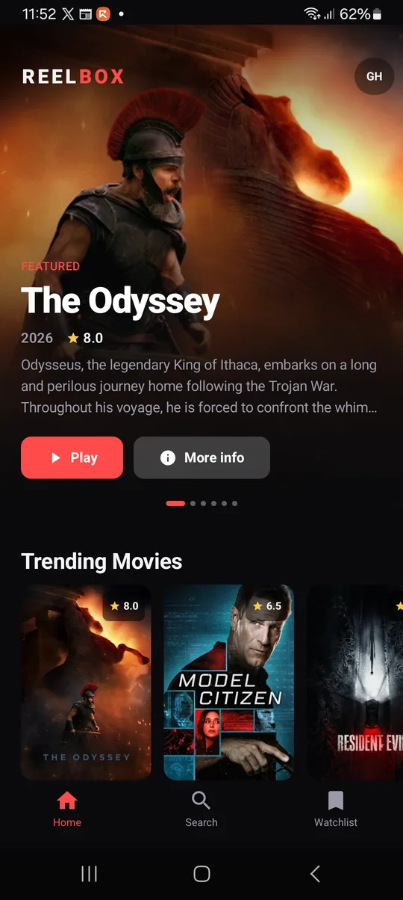
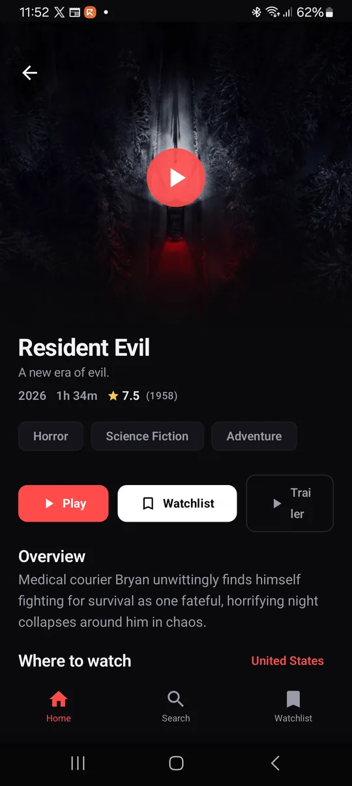
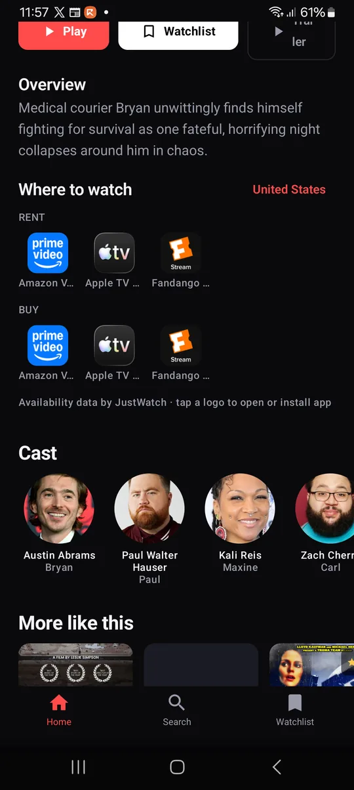
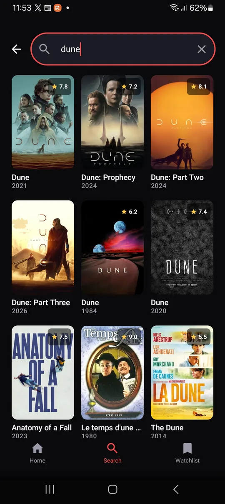

# Reelbox

A native Android movie & TV browser built with **Kotlin + Jetpack Compose**, powered by the
official [TMDB](https://www.themoviedb.org/) API.

Reelbox shows what is popular, what is trending, what is in theaters, and — most importantly —
**where each title is legally streaming** in your region, with a deep link to that service.

It does not host, index, embed, or stream any video.

<p align="center">
  
  
  
  
</p>

## Features

- **Home** — auto-advancing featured carousel plus trending movies, trending TV, top rated,
  in theaters, popular TV, and coming soon rows.
- **Search** — debounced multi-search across movies and TV, 3-column poster grid.
- **Detail** — backdrop header, genres, runtime/seasons, rating, overview, cast, trailer
  (opens YouTube), similar titles, and a **Where to watch** section driven by TMDB's
  `/watch/providers` data (JustWatch).
- **Watchlist** — saved locally as JSON in `SharedPreferences`; no account, no server.
- **Region picker** — tap the region pill in the top bar (or the region label on a detail
  screen) to change which country's streaming availability is shown. Default: `GH`.
- **Dark-only** cinema styling, edge-to-edge, Material 3.

## Add your TMDB key

Open `local.properties` and fill in **one** of these:

```properties
# v3 API key (32 hex chars)
TMDB_API_KEY=your_v3_key_here

# or the v4 API Read Access Token (starts with eyJ...), which takes priority
TMDB_READ_TOKEN=your_v4_token_here
```

Get them at <https://www.themoviedb.org/settings/api>. The file is git-ignored and the values
are injected as `BuildConfig` fields at build time.

The app supports both auth styles: a Bearer header when `TMDB_READ_TOKEN` is set, otherwise
`?api_key=` on each request.

## Build

Requirements: JDK 17–24 (this machine uses Homebrew `openjdk@21`), Android SDK 36.

```bash
./gradlew :app:assembleDebug
# APK: app/build/outputs/apk/debug/app-debug.apk
```

Install on a connected phone:

```bash
adb install -r app/build/outputs/apk/debug/app-debug.apk
```

Or open the `reelbox/` folder in Android Studio and press Run.

> `gradle.properties` pins `org.gradle.java.home` to the Homebrew JDK 21 because this machine's
> default JDK is 25, which Gradle 8.14 cannot run on. Remove that line if you open the project
> with Android Studio's bundled JDK.

## Website

`website/` holds the single-file marketing site (`index.html`, no build step) plus the
downloadable debug APK. Open it directly, or serve it locally:

```bash
cd website && python3 -m http.server 8899
```

Deployment notes are in [`website/README.md`](website/README.md).

## Project layout

```
app/src/main/java/dev/reelbox/
├── MainActivity.kt            # edge-to-edge host
├── ReelboxApplication.kt      # initialises the service locator
├── data/
│   ├── Models.kt              # @Serializable TMDB models + image URL helper
│   ├── TmdbApi.kt             # Retrofit interface
│   ├── TmdbClient.kt          # OkHttp + auth interceptor + JSON converter
│   ├── Repository.kt          # parallel home fetch, search, detail, similar
│   └── Stores.kt              # WatchlistStore, SettingsStore, Graph (manual DI)
└── ui/
    ├── ReelboxApp.kt          # NavHost: home / search / watchlist / detail
    ├── HomeScreen.kt          # carousel + poster rows
    ├── SearchScreen.kt
    ├── DetailScreen.kt        # detail + providers + cast + similar
    ├── WatchlistScreen.kt
    ├── ViewModels.kt          # StateFlow VMs, friendly error mapping
    ├── Common.kt              # poster cards, chips, dialogs, states
    └── theme/Theme.kt         # dark palette + type scale
```

## Attribution

This product uses the TMDB API but is not endorsed or certified by TMDB. Streaming availability
data is provided by JustWatch via TMDB.
